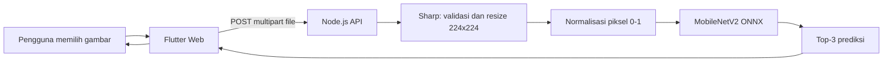

# Klasifikasi Kesegaran Buah

Proyek ini membangun sistem klasifikasi gambar untuk membedakan kondisi
**segar** dan **busuk** pada delapan jenis buah. Notebook utama proyek adalah
[`notebooks/proyek1.ipynb`](notebooks/proyek1.ipynb).

Model terbaik pada eksperimen notebook adalah **MobileNetV2 Transfer Learning**.
Model tersebut memperoleh akurasi validasi **94,53%** dan akurasi data uji
**94,11%** pada hasil yang tercatat di notebook.

> Sistem ini adalah demonstrasi machine learning. Hasil prediksi bukan
> pengganti pemeriksaan kualitas pangan secara profesional.

## Daftar isi

- [Problem statement](#problem-statement)
- [Tujuan](#tujuan)
- [Dataset dan label](#dataset-dan-label)
- [Struktur proyek](#struktur-proyek)
- [Teknologi](#teknologi)
- [Alur sistem](#alur-sistem)
- [Alur notebook](#alur-notebook)
- [Hasil eksperimen](#hasil-eksperimen)
- [Cara clone dan persiapan](#cara-clone-dan-persiapan)
- [Menjalankan notebook](#menjalankan-notebook)
- [Menjalankan aplikasi web](#menjalankan-aplikasi-web)
- [Deployment](#deployment)
- [Kesimpulan](#kesimpulan)
- [Rekomendasi](#rekomendasi)
- [Pembagian tugas](#pembagian-tugas)

## Problem statement

Penilaian kesegaran buah dari gambar dapat membantu membuat pemeriksaan awal
yang lebih cepat dan konsisten. Tantangannya adalah model harus mengenali
beberapa jenis buah sekaligus, membedakan kondisi segar dan busuk, serta tetap
dievaluasi pada data yang tidak digunakan saat pelatihan.

Dataset yang digunakan tidak menyediakan split train/validation/test. Karena
itu, proyek ini perlu melakukan pemeriksaan kualitas data, menghapus duplikat,
membuat split yang terstratifikasi, membangun pipeline gambar, dan
membandingkan beberapa arsitektur sebelum memilih model.

## Tujuan

1. Memahami isi dan kualitas dataset gambar buah.
2. Membersihkan data dari gambar rusak, duplikat, dan kemiripan lintas split.
3. Membuat split train, validation, dan test yang dapat diulang.
4. Menyiapkan input pipeline TensorFlow dengan ukuran gambar dan normalisasi
   yang konsisten.
5. Membandingkan model baseline, CNN, dan transfer learning.
6. Mengevaluasi model terpilih pada data uji menggunakan metrik klasifikasi.
7. Menyediakan demo prediksi melalui Flutter Web dan API Node.js.

## Dataset dan label

Arsip dataset yang dipakai notebook adalah `Fruits Dataset.zip` di
`data/raw/`. Arsip berisi folder `Original Image/` dan 16 kelas:

- Apel, pisang, anggur, jambu biji, bidara, jeruk, delima, dan stroberi.
- Setiap jenis memiliki kondisi `Fresh` atau `Rotten`.

Notebook memetakan label menjadi nama berbahasa Indonesia, misalnya `Segar
Apel` dan `Busuk Apel`. Model menghasilkan salah satu dari 16 kelas tersebut.

## Struktur proyek

```text
README.md
requirements.txt
render-node.yaml
.github/
  workflows/
    deploy-huggingface-space.yml
frontend/                 # Aplikasi Flutter Web
backend-node/             # API Express dengan ONNX Runtime
models/                   # Checkpoint, metadata, dan model deployment
notebooks/
  proyek1.ipynb           # EDA, praproses, pipeline, training, evaluasi
data/
  raw/                    # Arsip dataset lokal
  processed/              # Hasil ekstraksi dan split data
results/                  # CSV, grafik, dan hasil eksperimen
docs/
  pembagian_tugas.md
laporan/
video/
```

Dataset mentah dan sebagian artefak model berukuran besar dikelola dengan
Git LFS atau disiapkan secara lokal sesuai kebutuhan.

## Teknologi

| Area | Teknologi |
|---|---|
| Eksplorasi dan training | Python, Jupyter, TensorFlow/Keras |
| Pengolahan data | NumPy, pandas, Pillow, scikit-learn |
| Visualisasi | Matplotlib, seaborn |
| Model deployment | MobileNetV2, ONNX, ONNX Runtime |
| Backend | Node.js, Express, Sharp, Multer |
| Frontend | Flutter Web, Dart |
| Hosting frontend | Hugging Face Static Space |
| Otomasi deployment | GitHub Actions |

## Alur sistem



API menyediakan:

- `GET /api/health` untuk memeriksa kesiapan model.
- `POST /api/predict` dengan field multipart `file` untuk prediksi.

Backend menolak gambar yang confidence tertingginya di bawah 60% dengan pesan
bahwa gambar bukan buah yang dikenali. Ambang ini adalah heuristik karena model
tidak dilatih dengan kelas khusus `bukan buah`.

## Alur notebook

Pembahasan notebook dibagi mengikuti bagian utamanya.

### Bagian 1 — Setup dan konfigurasi

Notebook mengatur seed acak `42`, ukuran gambar `224 x 224`, batch size `32`,
maksimal `20` epoch, dan learning rate `0,0001`. Output notebook mencatat
TensorFlow `2.21.0` dan tidak mendeteksi GPU pada eksekusi tersebut.

### Bagian 2 — Ekstrak dan muat dataset

Arsip `Fruits Dataset.zip` diekstrak ke `data/processed/Fruits Dataset/`.
Notebook membentuk tabel berisi lokasi gambar dan label untuk 16 kelas.

### Bagian 3 — Jumlah gambar per kelas

Notebook menghitung distribusi gambar pada setiap kelas sebagai dasar
pengecekan keseimbangan dataset.

### Bagian 4 — Resolusi dan format gambar

Resolusi, ekstensi, dan atribut gambar diperiksa sebelum gambar digunakan untuk
training.

### Bagian 5 — Contoh gambar

Notebook menampilkan contoh untuk setiap kombinasi jenis buah dan kondisi agar
label serta isi gambar dapat diperiksa secara visual.

### Bagian 6–8 — Praproses dan duplikat

Praproses mencakup pemeriksaan gambar rusak, MD5 untuk isi file, dan dHash
untuk gambar yang hampir sama.

Hasil yang tercatat:

- Data awal: **3.200 gambar**.
- Gambar rusak: **0**.
- Gambar yang dibuang: **36**, terdiri dari 7 duplikat persis dan 29 gambar
  hampir sama.
- Data setelah pembersihan: **3.164 gambar**.

File hasilnya adalah `data/processed/split.csv` dan
`data/processed/gambar_dibuang.csv`.

### Bagian 9 — Kelas timpang

Distribusi kelas dinilai hampir seimbang sehingga tidak dilakukan oversampling
atau undersampling. Bobot kelas hanya disiapkan sebagai opsi jika rasio kelas
terbesar dan terkecil melebihi 1,5.

### Bagian 10–12 — Split dan pemeriksaan kebocoran

Data dibagi secara stratified dengan rasio:

| Split | Jumlah |
|---|---:|
| Train | 2.214 |
| Validation | 475 |
| Test | 475 |
| Total | 3.164 |

Notebook memeriksa agar tidak ada file, MD5, atau gambar hampir sama yang
masuk ke split berbeda. Setiap kelas juga harus muncul di ketiga split.

### Bagian 13 — Input pipeline `tf.data`

Pipeline membaca gambar, resize ke `224 x 224`, mengubah piksel ke rentang
`0–1`, membuat batch berukuran 32, dan melakukan prefetch.

Augmentasi hanya digunakan pada train berupa flip horizontal dan rotasi ringan.
Validation dan test tidak diacak serta tidak diaugmentasi. Hasil pipeline
disimpan di `results/figures/`, termasuk contoh batch, perbandingan augmentasi,
dan demo tensor.

### Bagian 14 — Model dan pelatihan

Lima percobaan dilatih dengan Adam, learning rate `1e-4`, loss
`sparse_categorical_crossentropy`, dan early stopping berdasarkan `val_loss`:

1. MLP baseline.
2. CNN dasar.
3. CNN dengan BatchNorm dan Dropout.
4. CNN dengan BatchNorm, Dropout, dan augmentasi.
5. MobileNetV2 Transfer Learning dengan bobot ImageNet dan base model dibekukan.

Model dipilih berdasarkan akurasi validation tertinggi, dengan loss validation
sebagai penentu jika akurasinya sama. Model terpilih disimpan sebagai
`models/model_terbaik.keras` beserta metadata JSON.

### Bagian 15 — Evaluasi akhir

Model terbaik dimuat ulang dan dievaluasi satu kali pada 475 gambar test.
Data test tidak digunakan untuk memilih model. Notebook menghitung accuracy,
precision, recall, F1-score, dan confusion matrix.

## Hasil eksperimen

Tabel berikut berasal dari output notebook:

| Percobaan | Parameter | Akurasi train | Akurasi val | Loss val |
|---|---:|---:|---:|---:|
| MLP baseline | 38.570.384 | 0,6423 | 0,5895 | 1,2540 |
| CNN dasar | 3.454.288 | 0,9413 | 0,8484 | 0,4406 |
| CNN + BatchNorm + Dropout | 3.455.344 | 0,1021 | 0,0632 | 2,8996 |
| CNN + BatchNorm + Dropout + Augmentasi | 3.455.344 | 0,2602 | 0,4337 | 2,0090 |
| MobileNetV2 Transfer Learning | 2.278.480 | 0,9336 | **0,9453** | 0,2845 |

Model terbaik adalah MobileNetV2 Transfer Learning. Setelah disimpan dan
dimuat ulang, notebook mencatat validation accuracy tetap `0,9453`.

### Evaluasi test MobileNetV2

Pada 475 gambar test, notebook mencatat:

- Accuracy: **0,9411**
- Macro average: precision **0,943**, recall **0,941**, F1-score **0,941**
- Weighted average: precision **0,943**, recall **0,941**, F1-score **0,941**

Confusion matrix dan grafik training disimpan di `results/figures/`.

## Cara clone dan persiapan

Pastikan Git, Git LFS, Python 3.10 atau lebih baru, Node.js 20 atau lebih
baru, dan Flutter sudah tersedia.

```powershell
git lfs install
git clone https://github.com/carlos1739/fruit_freshness_classification.git
cd fruit_freshness_classification
git lfs pull
```

Untuk menyiapkan Python:

```powershell
py -m venv .venv
.\.venv\Scripts\Activate.ps1
python -m pip install --upgrade pip
pip install -r requirements.txt
```

Jika PowerShell tidak mengizinkan aktivasi environment:

```powershell
.\.venv\Scripts\python.exe -m pip install -r requirements.txt
```

Arsip `Fruits Dataset.zip` harus tersedia di `data/raw/` sebelum notebook
dijalankan.

## Menjalankan notebook

```powershell
.\.venv\Scripts\python.exe -m jupyter notebook notebooks/proyek1.ipynb
```

Jalankan sel dari atas ke bawah. Notebook mengharapkan dataset lokal dan akan
menghasilkan split, grafik, tabel hasil, serta checkpoint model di folder
proyek.

## Menjalankan aplikasi web

### Backend Node.js

Backend menggunakan `models/model_mobilenet.onnx`. Jika file ONNX belum ada,
konversi checkpoint Keras pada mesin yang memiliki TensorFlow:

```powershell
python -m pip install tensorflow==2.21.0 tf2onnx==1.17.0
python backend-node/convert_model_onnx.py
```

Lalu jalankan API:

```powershell
cd backend-node
npm install
npm start
```

Uji API dari terminal lain:

```powershell
curl http://127.0.0.1:7860/api/health
```

### Frontend Flutter

```powershell
cd frontend
flutter pub get
flutter run -d chrome --web-port 5000 `
  --dart-define=API_BASE_URL=http://127.0.0.1:7860
```

## Deployment

Frontend dapat dipublikasikan sebagai Hugging Face Static Space, sedangkan API
harus berjalan pada layanan Node.js terpisah. Workflow deployment berada di
`.github/workflows/deploy-huggingface-space.yml`.

Variable/secret yang diperlukan workflow:

- `HF_TOKEN`: token dengan izin menulis ke Space.
- `HF_SPACE_ID`: `Carlos-leo/klasifikasi-kesegaran-buah`.
- `RENDER_API_URL`: URL HTTPS API yang dipakai frontend.

Urutan deployment:

1. Pastikan API Node.js aktif dan endpoint `/api/health` mengembalikan status
   `ok`.
2. Set `RENDER_API_URL` ke URL publik API.
3. Jalankan workflow **Deploy Flutter Web to Hugging Face Static Space**.
4. Buka `https://carlos-leo-klasifikasi-kesegaran-buah.static.hf.space`.
5. Jika cache masih menampilkan versi lama, lakukan hard refresh.

Cloudflare Quick Tunnel dapat digunakan untuk pengujian. URL Quick Tunnel
bersifat sementara dan dapat berubah saat tunnel atau VPS dimulai ulang.

## Kesimpulan

Pipeline proyek berhasil mengubah 3.200 gambar awal menjadi 3.164 gambar yang
telah dibersihkan dan dibagi secara stratified. Dari lima percobaan, MobileNetV2
Transfer Learning menghasilkan validation accuracy tertinggi, yaitu 94,53%.
Evaluasi pada data test menghasilkan accuracy 94,11% dengan macro F1-score
0,941.

Model ini kemudian digunakan pada API Node.js melalui ONNX Runtime dan
diakses oleh frontend Flutter Web. Karena data training hanya berisi kelas
buah, kemampuan mendeteksi gambar bukan buah di aplikasi menggunakan heuristik
confidence dan bukan kelas non-buah yang dilatih secara khusus.

## Rekomendasi

1. Tambahkan dataset non-buah dan latih kelas `bukan buah` agar penolakan input
   memiliki dasar model, bukan hanya threshold confidence.
2. Evaluasi pada foto dari kondisi pencahayaan, kamera, dan latar belakang yang
   lebih beragam.
3. Simpan versi dataset, konfigurasi, dan environment setiap eksperimen agar
   hasil mudah direproduksi.
4. Gunakan Cloudflare Tunnel bernama atau domain tetap untuk deployment
   produksi; Quick Tunnel dapat mengganti URL setelah restart.
5. Tambahkan pengujian otomatis untuk endpoint health, prediksi valid, file
   non-gambar, dan file berukuran terlalu besar.

## Pembagian tugas

| Anggota | Bagian utama |
|---|---|
| Carlos Leonardo J. Dongoran | Memulai proyek dengan menyiapkan notebook dan mengenali isi dataset. Ia memuat data, menghitung jumlah gambar per kelas, memeriksa resolusi dan format, lalu menampilkan beberapa contoh gambar sebagai pemeriksaan awal (bagian 1–5). |
| Percaya Mendrova | Menyiapkan dataset agar aman digunakan untuk pelatihan. Ia memeriksa gambar rusak, mencari duplikat, melihat keseimbangan kelas, membuat split train/validation/test, dan memastikan tidak ada kebocoran data antar-split (bagian 6–12). |
| Matthew Rivandi | Menyusun input pipeline `tf.data` yang mengubah gambar menjadi batch siap pakai. Ia juga memeriksa bentuk tensor, normalisasi piksel, serta augmentasi yang hanya digunakan pada data train (bagian 13). |
| Joni Fernando | Membangun dan melatih lima pendekatan model, mulai dari baseline MLP dan CNN sampai transfer learning MobileNetV2. Hasil setiap percobaan dibandingkan pada data validation, lalu model terbaik disimpan bersama metadata (bagian 14). |
| Yohanes Cornelius Willfredi Simanjuntak | Melakukan evaluasi akhir pada data test setelah model terbaik ditentukan. Ia menghitung beberapa metrik klasifikasi, membuat confusion matrix, dan menjelaskan hasil serta kesalahan prediksi yang terlihat (bagian 15). |

Rincian pembagian tugas tersedia di
[`docs/pembagian_tugas.md`](docs/pembagian_tugas.md).
